# CoherencyLatency Android 图形界面版 · 使用说明

**版本：** 1.3.0（versionName `1.3.0`，versionCode 5，2026-11-25 第二次修订构建）
**安装包：** `CoherencyLatency-Android-UI-v1.3.0.apk`（545,943 B / 533.1 KiB）
**适用系统：** Android 4.1（API 16）及以上
**架构：** 同一个 APK 内含 arm64-v8a、armeabi-v7a、x86、x86_64 四个原生库，安装时自动选择
**界面：** 手机、平板、圆形手表、Android TV 共用一个 APK，自动适配
**许可：** MIT（基于 CapFrameX 的 MicroBenchX v1.0.5）
**本次修订：** 结果矩阵改为与 Windows/macOS/鸿蒙一致的单元格背景热力填充（此前热力色误涂在文字上）；64 位库按 16 KB 页面对齐、移除可调试标记、触摸屏按钮一次点按即生效、跟随系统深色模式

---

## 1. 这是什么

`CoherencyLatency` 测量一条缓存行在两个逻辑 CPU 之间来回传递需要多少纳秒。它来自
[MicroBenchX v1.0.5](https://github.com/CXWorld/MicroBenchX) 的 `CoherencyLatency`，本 APK 是它的 Android 原生移植版，
测量核心用 C++ 写成（`libclbench.so`），外面套一层轻量 Java 界面：

- 参数固定为默认值（全部逻辑核心、1,000,000 次、3 轮、Bounce），点一下就开始；
- **测量过程中实时显示进度和矩阵**，不用等全部跑完；
- 随时可以停止，已测出的部分结果保留；
- 完成后自动保存 CSV，也可以点按钮**手动导出**到你选的位置；
- 某个核心对无法真正绑定时，矩阵和 CSV 显示 **N/A**，不会拿错 CPU 的数字冒充结果；
- 不联网、不申请任何权限、不需要 root、没有广告；
- 同一份 APK 在手机、平板、圆形手表和 Android TV 上都能用，不需要装不同版本；
- 系统要求低到 **Android 4.1（API 16）**，32 位 ARM、64 位 ARM、32 位 x86、64 位 x86 都有原生库。

界面长这样（手机模拟器截图）：

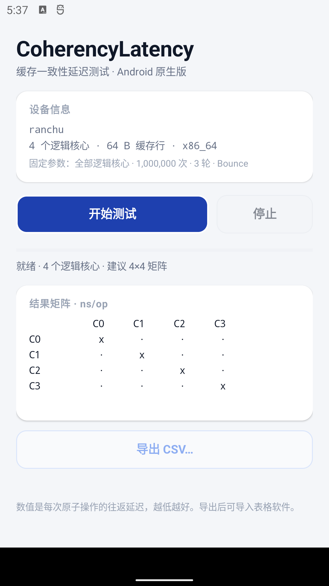

---

## 2. 安装

### 2.1 手机 / 平板

任选一种方式把 APK 传到设备：

- 数据线：选「文件传输 / MTP」，把 APK 拷进「下载」目录；
- 网盘 / 微信文件传输助手 / 邮件附件：先存到设备，再从文件管理器打开；
- `adb install`（调试用）：

```bash
adb install -r CoherencyLatency-Android-UI-v1.3.0.apk
```

Android 4.1~7：设置 → 安全 → 允许「未知来源」（4.x 在「设置 → 安全 → 未知来源」）。

Android 8 及以上：点开 APK 后系统会提示「为了安装此应用，请允许此来源」，
打开对应文件管理器/浏览器的开关，返回后继续安装即可。

Android 4.1~4.4 上没有系统的「保存到…」文件选择器，**导出 CSV…** 按钮会直接把文件
存到应用私有目录并提示路径，取文件用数据线或 `adb pull`（见 6.5 节）。

### 2.2 Android TV / 电视盒子

电视通常没有文件管理器，推荐用 adb 安装：

```bash
adb connect 192.168.1.50:5555     # 电视开启「网络调试」后；USB 调试也可
adb install -r CoherencyLatency-Android-UI-v1.3.0.apk
```

装好后在电视的「应用」列表里会出现 **CoherencyLatency**（带 TV 横幅）。
部分品牌电视会限制第三方 APK，需要在开发者选项里允许「未知来源」或关闭安装校验。
电视没有触摸屏，全程用遥控器操作，见 3.4 节。

### 2.3 Wear OS 手表

手表用 adb 安装（先在手表开发者选项里开启「ADB 调试」，USB 或 Wi-Fi adb 均可）：

```bash
adb install -r CoherencyLatency-Android-UI-v1.3.0.apk
```

APK 里已声明 `com.google.android.wearable.standalone = true`，可以独立运行。
部分手表系统对第三方 APK 有额外限制，装不上时请以实际系统提示为准。
圆形表盘的布局是按 454×454 圆形屏幕做的，见 3.3 节。

### 2.4 安装并打开

桌面出现蓝色矩阵图标 **CoherencyLatency**，点开即可。首次启动约 1 秒。

> 如果提示「应用未安装」或「签名不一致」：设备里可能装过另一份同包名
> （`com.ddyibb.coherencylatency`）的测试包，先卸载旧的再装。
> 本 APK 使用 Android 调试证书签名，只用于本地测试分发，不上架应用商店。

### 2.5 支持的系统与架构

| 项目 | 支持范围 |
|---|---|
| 系统版本 | Android 4.1（API 16）～ Android 15 |
| 32 位 ARM | `armeabi-v7a`，Android 4.1+ 老手机、老电视盒子 |
| 64 位 ARM | `arm64-v8a`，2015 年以后的主流手机/平板/电视 |
| 32 位 x86 | `x86`，老 Atom 平板、x86 模拟器 |
| 64 位 x86 | `x86_64`，x86 模拟器、Chromebook |

安装时系统按设备的 ABI 自动挑选对应原生库，用户不需要选。四个 ABI 打包在同一个 APK 里，
所以文件比只带 arm64 的包大一些，但没有额外权限、没有额外依赖。

64 位原生库（`arm64-v8a`、`x86_64`）的 ELF LOAD 段按 **16 KB 页面对齐**（`p_align = 0x4000`），
所以在 Android 15 及以后支持 16 KB 页面大小的设备上不会再出现「此应用不符合 16 KB 对齐要求」
的兼容性提示；32 位库保持 4 KB 对齐，以兼容老设备。APK 本身不再带 `debuggable` 标记，
安装时不会提示「可调试应用」。

Android 4.1 实测截图（480×800 模拟器，API 16）：

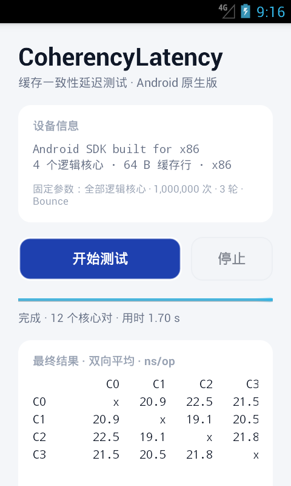

Android 4.1 上界面用的是系统自带的 Holo 主题（Android 5.0+ 自动换成 Material），
功能、矩阵、CSV 与高版本完全一致。

界面会跟随系统的深色模式：系统切到深色后，背景、卡片、文字、边框和进度条一起换成深色配色，
热力矩阵的绿→黄→红刻度和色条保持不变（它们是数据刻度，不随主题变）。切换主题时 Activity 会重建，
正在跑的测试会被中断，建议跑之前先确认主题。

---

## 3. 界面说明

### 3.1 手机（竖屏单列）


从上到下：

| 区域 | 内容 |
|---|---|
| 设备信息 | 机型、逻辑核心数、缓存行大小、ABI。这些值由原生层读取，不是猜的。 |
| 固定参数 | 全部逻辑核心 · 1,000,000 次 · 3 轮 · Bounce。这一版不提供调节项，打开即可测。 |
| 开始测试 / 停止 | 开始后「停止」才可用；停止会保留已完成的部分结果。 |
| 进度行 | 例如「测量中 4/12 · C1↔C0 33.7 ns · 用时 4.8 s」；绑核失败时显示「C1↔C0 N/A（绑核失败）」。 |
| 结果矩阵 | 实时刷新，单位 ns/op；未测的格子显示 `·`，对角线显示 `x`，绑核失败显示 `N/A`。 |
| 导出 CSV… | 手动选择保存位置（系统文件选择器）。 |

### 3.2 平板 / 大屏横屏（两栏）

平板横放、宽度达到 600dp 时自动切成左右两栏：

- 左栏：标题、设备信息、开始/停止、进度、导出；
- 右栏：结果矩阵和说明文字。

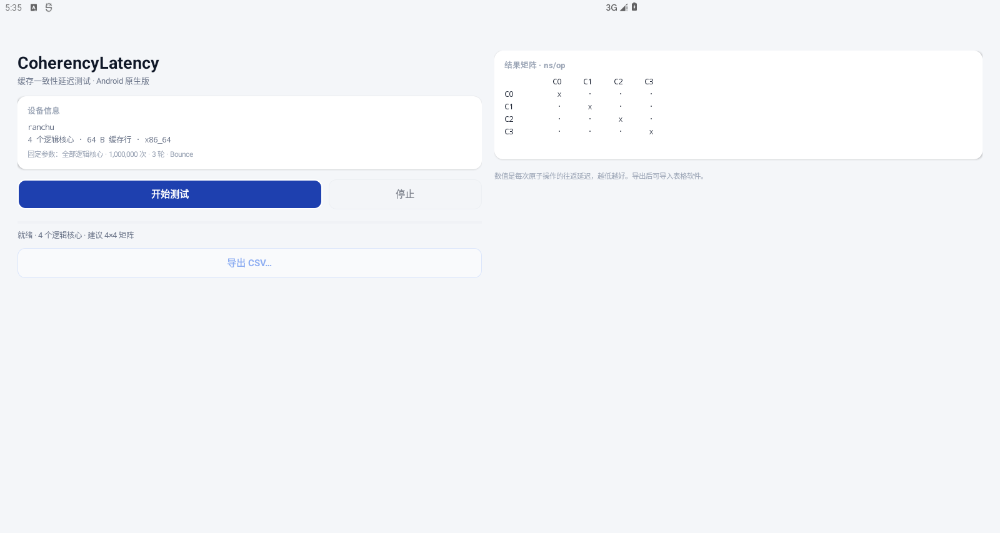

平板竖放时仍是单列（与手机相同）。截图使用 1600×1000、160dpi 的模拟器配置，
真机平板上字号会按系统缩放，实际观感通常比截图更大。

### 3.3 圆形手表（紧凑滚动）

手表上首屏只放最常用的内容，保证 454×454 的圆形表盘内能看到开始按钮：

```text
CoherencyLatency
缓存一致性测试
[ 开始测试 ] [ 停止 ]
──────────────
就绪 · 4 核 · 4×4 矩阵
```

设备信息、结果矩阵和导出按钮在下方，手指上下滑动查看。圆形预览图里圆外的黑色
只是截图遮罩，实际屏幕是圆的：

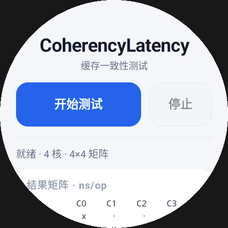

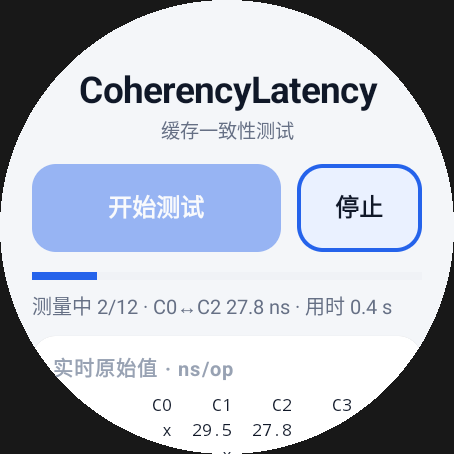

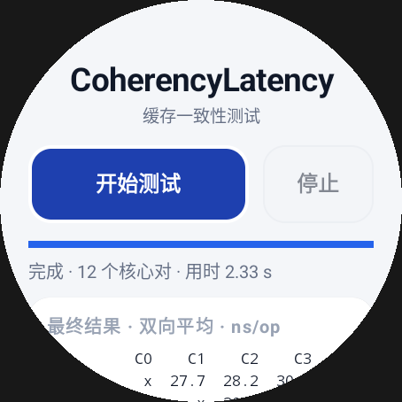

矩阵在圆底会被自然截断，继续向上滑动就能看到完整的 4×4 矩阵和 **导出 CSV…** 按钮：

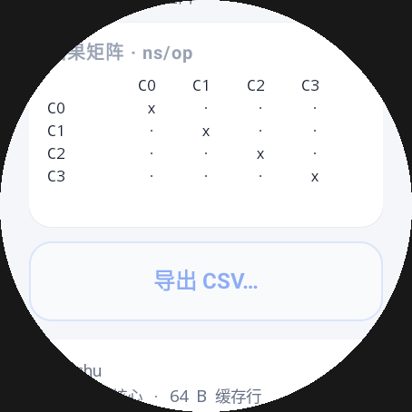

### 3.4 Android TV（遥控器 / D-pad）

Android TV 上界面按 1.7 倍放大，并用左右两栏铺满 16:9 屏幕：

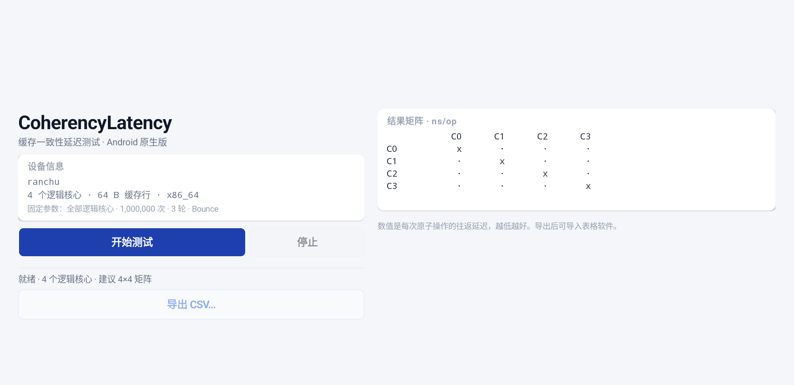

遥控器操作：

| 按键 | 作用 |
|---|---|
| 方向键 | 在按钮之间移动焦点，当前焦点有蓝色描边/底色 |
| 确定 / OK | 按下当前按钮（开始、停止或导出） |
| 返回 | 关闭系统文件选择器，回到主界面 |

启动后焦点自动落在 **开始测试**；运行中自动落到 **停止**；跑完后自动落到 **导出 CSV…**。
所以最常见的流程只需要按两次「确定」：开始 → 等完成 → 导出。

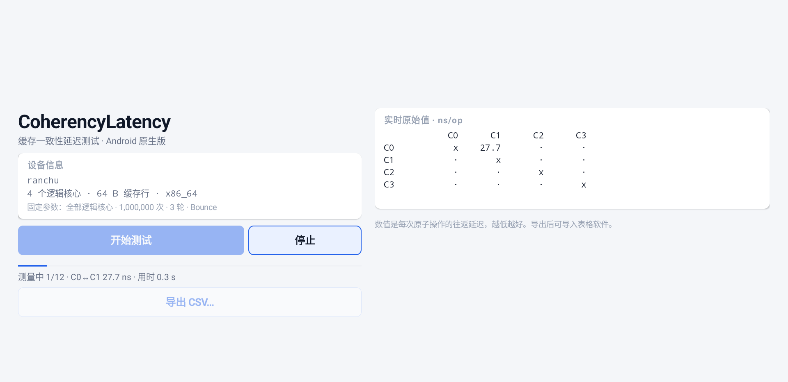

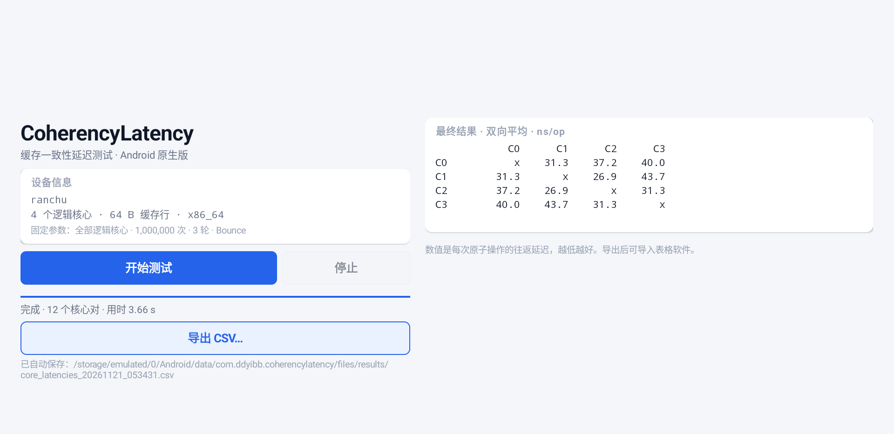

> 以上 TV/手表截图是在同一台手机模拟器上用调试参数切换形态后截的，分辨率和布局
> 与真实设备一致；真实电视的焦点样式、系统文件选择器外观可能略有不同。

---

## 4. 做一次测试

参数固定为默认值（全部逻辑核心 / 100 万次 / 3 轮 / Bounce），直接点 **开始测试** 即可。

运行中会看到实时进度和逐渐填满的矩阵：

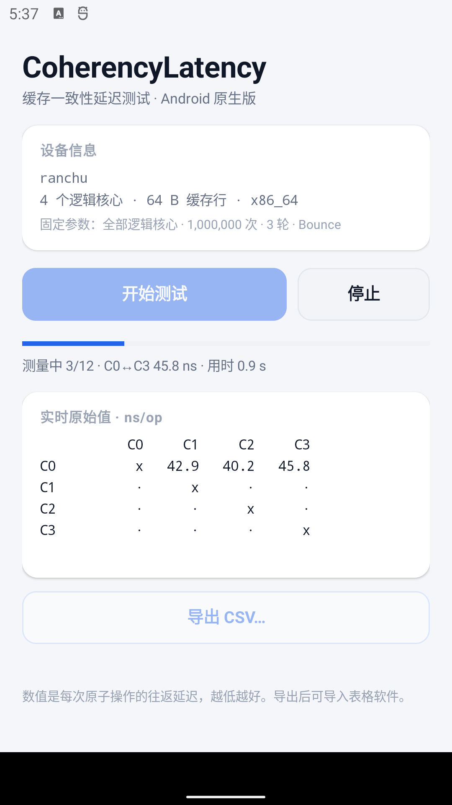

- 4 核模拟器上 12 个核心对约 2.5~4 秒跑完（受系统负载影响）；核心越多耗时越长；
- 中途点 **停止**，已完成的格子会保留，标题变成「已停止 · 部分结果」；
- 跑完后标题变成「最终结果 · 双向独立 · ns/op」，并自动保存 CSV。

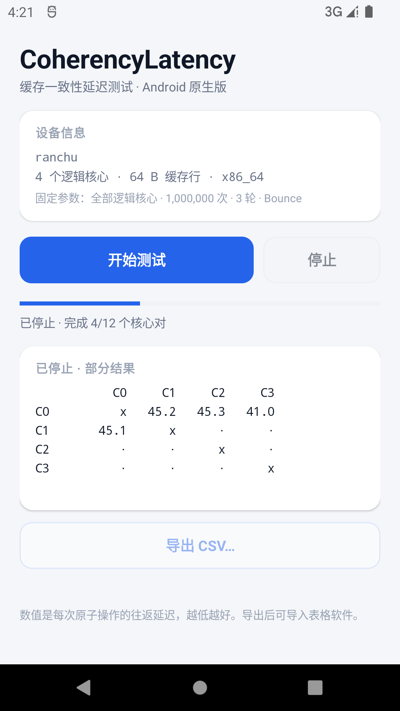

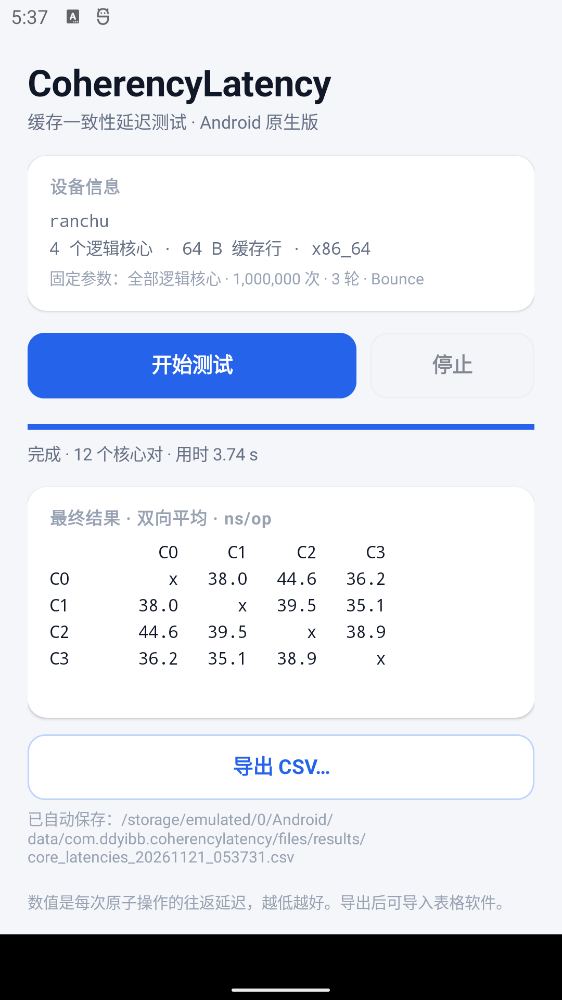

在手表上，开始按钮就在首屏；在电视上，按遥控器「确定」即可开始。

---

## 5. 结果怎么看


- 单位是 **ns/op**：一次原子操作往返的延迟，**越低越好**；
- 矩阵是**双向独立**的：`C0` 行 `C1` 列是 C0→C1，`C1` 行 `C0` 列是 C1→C0，两个方向分别测量，数值可以不同；
- 对角线是 `x`（自己到自己没有意义），没测的格子是 `·`；
- `N/A` 表示这个核心对**绑核失败**：至少一个线程没有真正待在请求的 CPU 上，数值不可用；
  它不是 0，也不是「延迟特别高」；
- 同一颗 SoC 上，Bounce 通常在几十纳秒；Owned 因为要跨两次缓存行，数值一般更高。

绑核失败时的矩阵长这样（这里把 CPU3 置为离线制造失败，C3 行列全部是 `N/A`，其余核心对照常出数）：

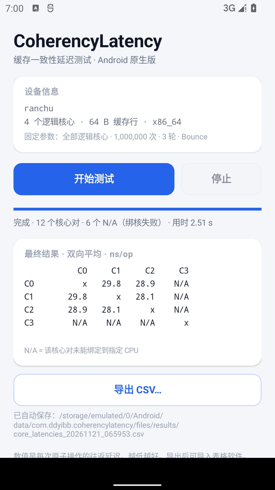

**注意这不是「物理核心 i ↔ 物理核心 j」的精确延迟。** Android 的
`sched_setaffinity` 可能被 cpuset、离线核心或厂商调度器拒绝。本次构建会检查实际
CPU，无法保持绑定的核心对在矩阵和 CSV 里写 `N/A`，其余核心对照常完成。
即使绑定成功，矩阵下标仍是**逻辑槽位**，适合横向对比同一台设备上的变化
（例如大小核差异、降频前后），不适合拿两个型号的设备直接比绝对值。

---

## 6. 保存与导出 CSV

### 6.1 自动保存

每次跑完会自动保存一份到应用私有目录：

```text
/sdcard/Android/data/com.ddyibb.coherencylatency/files/results/core_latencies_YYYYMMDD_HHMMSS.csv
```

界面底部会显示完整路径。卸载应用时这个目录会一起删除。

### 6.2 手动导出

1. 点 **导出 CSV…**（手表上先向下滑动找到它；电视上用方向键把焦点移过去）；
2. 系统文件选择器里选目录（例如「下载 / Download」）；
3. 文件名默认 `core_latencies_<时间>.csv`，可改；
4. 点 **SAVE**，界面提示「已导出 CSV：文件名」。

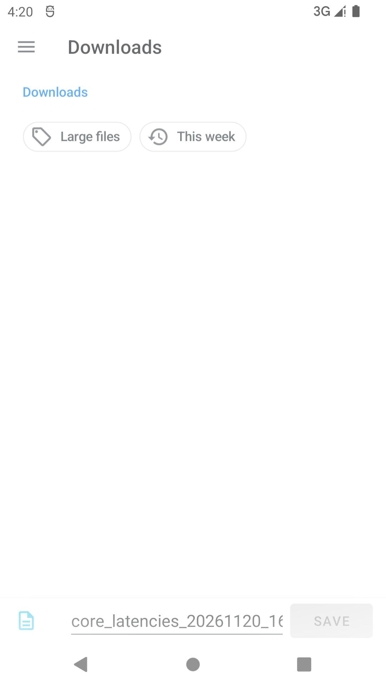

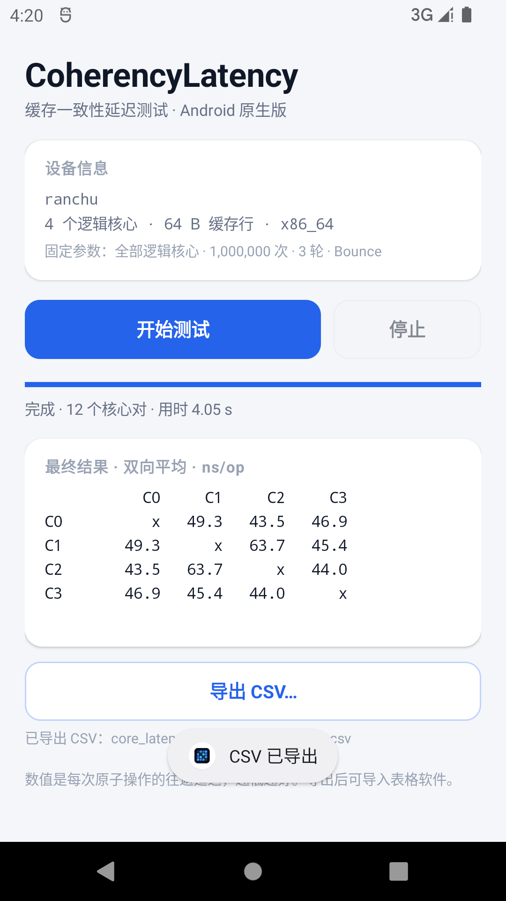

导出的文件与自动保存的那份内容完全相同（可用 SHA-256 比对）。导出不需要存储权限，
因为走的是系统 SAF 选择器。电视/手表上没有文件管理器时，选择器仍由系统提供。

### 6.3 取回电脑

- 数据线 MTP：直接进「下载」目录复制；
- 或 adb：

```bash
adb pull /sdcard/Download/core_latencies_20261120_131055.csv
```

### 6.4 CSV 格式

分号分隔，第一行第一格为空，随后是 `Core 0` … `Core N-1`；对角线写 `x`：

```text
;Core 0;Core 1;Core 2;Core 3
Core 0;x;33.8422;34.914;34.1536
Core 1;33.8422;x;32.401;31.998
Core 2;34.914;32.401;x;30.775
Core 3;34.1536;31.998;30.775;x
```

数值有效位数约 6 位（`%.6g`），与 macOS / Windows / CLI 版输出格式一致，
可直接用 Excel、Numbers、Python `pandas.read_csv(sep=';')` 打开。
若某个核心对绑核失败，该对的两个方向都写 `N/A`（CSV 里不是 0）。

### 6.5 Android 4.1~4.4 上的保存位置

这些老系统没有 SAF 文件选择器，也拿不到 `/sdcard/Android/data/...`，文件会写进应用私有目录：

```text
/data/data/com.ddyibb.coherencylatency/files/results/core_latencies_YYYYMMDD_HHMMSS.csv
```

界面底部会显示这个完整路径。取回电脑用 adb（不需要 root）：

```bash
adb shell run-as com.ddyibb.coherencylatency cat files/results/core_latencies_20261121_091632.csv > core_latencies.csv
```

或者先 `adb shell run-as com.ddyibb.coherencylatency ls files/results` 看有哪些文件。
在 4.x 上点 **导出 CSV…** 只是再存一份到同一目录并提示路径，不会弹文件选择器。

## 7. 默认参数与耗时

这一版固定使用默认参数：

| 参数 | 固定值 |
|---|---|
| 核心数 | 全部逻辑核心（设备报告多少就用多少） |
| 迭代次数 | 每个线程每轮 1,000,000 次原子操作 |
| 采样轮数 | 3 轮，最终取最快的一轮 |
| 模式 | Bounce 争用（两个线程抢同一条缓存行） |

核心数是 `n` 时共有 `n × (n-1)` 个有序核心对：4 核 12 对（模拟器约 2.5~4 秒），
8 核 56 对，12 核 132 对。核心越多耗时越长，手机发热或后台任务多时也会变慢。
需要中途结束就点 **停止**，已完成的格子会保留。
若某个核心当前离线（热插拔）或被系统 cpuset 排除，涉及它的核心对会显示 `N/A`，
其余核心对仍会跑完。

---

## 8. 常见问题

**Q：为什么没有核心数、迭代次数等选项？**
A：这一版固定使用默认参数（全部逻辑核心、100 万次、3 轮、Bounce），打开点开始即可，避免误调参数。

**Q：数值每次都不一样。**
A：正常。设备有温控、后台任务、大小核迁移，同一台机器相邻两次差几纳秒很常见。
想对比就固定参数、连续测 3 次取中位数。

**Q：为什么有格子是 N/A？**
A：这个核心对没有真正绑定成功。常见原因有：某个 CPU 正处于离线/热插拔状态、系统
cpuset 把应用限制在部分核心、厂商调度器拒绝或忽略了 `sched_setaffinity`、模拟器的
CPU 配置不完整。`N/A` 表示**该对数值不可用**，不是延迟高，也不是 0。其余核心对仍会
正常完成；在设备空闲、屏幕点亮、性能模式下重测，或换一台没有核限制的设备再试。
如果所有格子都是 `N/A`，说明当前进程拿不到任何一个请求的核心，通常是系统级限制。

**Q：Bounce 和 Owned 差多少？**
A：Owned 一般明显更高，因为它有两次跨缓存行访问；具体倍数取决于 SoC 和缓存层级。
这一版 APK 固定 Bounce，不提供 Owned 切换。

**Q：按钮点一下没反应，要点两下？**
A：1.2.0 之前的构建在触摸屏上会这样：第一次点按只把焦点移到按钮上。1.2.0 已修复，
单击即生效；如果你还在旧版本，请重新安装当前 APK。

**Q：测试中途失败，矩阵只出了一部分？**
A：1.2.0 起单对超时或绑核失败只会把该对标记为 `N/A`，其余核心对继续跑完，不再整张矩阵作废。
若大量出现，先让设备空闲、亮屏、切性能模式再测。

**Q：测到一半能停吗？**
A：可以。点「停止」后线程会退出，已完成的格子保留，标题显示「已停止 · 部分结果」。

**Q：点导出没反应 / 保存失败。**
A：确认在系统文件选择器里选了目录并点了 SAVE；某些定制系统会二次确认。若仍失败，
用界面上的自动保存路径通过数据线取文件。

**Q：安装被 Play Protect 拦截。**
A：这是调试签名的自编译应用，选择「仍要安装」即可；不放心可以自己从源码构建。

**Q：需要 root 吗？需要联网吗？**
A：都不需要。APK 没有申请任何权限（包括网络权限）。

**Q：模拟器上测的值能代表手机吗？**
A：不能。模拟器跑在 PC 上，缓存层级和调度都与真机不同，只适合验证功能。
真机数值才有参考意义。

**Q：平板/电视上字太小或太大？**
A：布局按屏幕宽度和 dpi 自动切换：平板横屏两栏、电视 1.7 倍放大、手机单列。
不同厂商的系统字体缩放也会影响观感；电视上建议用遥控器靠近看。

**Q：手表上找不到矩阵或导出按钮？**
A：手表首屏优先放开始/停止，矩阵和导出在下方；手指上下滑动即可，矩阵右侧和底部还可以继续滚。

**Q：电视遥控器怎么开始？**
A：启动后焦点在「开始测试」，按遥控器中间的 OK/确定 即可；跑完后焦点会自动跳到「导出 CSV…」。

**Q：手表/电视怎么安装？**
A：两者都推荐 `adb install`，见 2.2 / 2.3 节。电视需要在开发者选项允许未知来源，
手表需要开启 ADB 调试。

**Q：为什么手表预览图四角是黑的？**
A：那是圆形遮罩预览图，黑色部分不在真实屏幕内；真机是完整圆形表盘。

**Q：这个 APK 支持横屏吗？**
A：支持。手机/平板旋转后按新宽度重新布局；平板横屏会自动切成左右两栏。

**Q：和命令行版有什么区别？**
A：测量核心、参数含义、CSV 格式完全相同；APK 只是多了一层图形界面和实时显示。
命令行版（Termux/adb）仍在 `03-Android-arm64-armv7-x86-x86_64` 文件夹里，适合脚本化批量跑。

---

## 9. 资源占用

以模拟器（4 核 / 100 万 / 3 轮 / Bounce）跑完后的 `dumpsys meminfo` 为例：

| 项目 | 数值 |
|---|---|
| Native Heap Pss | 16,232 KB（约 15.9 MiB） |
| Dalvik Heap Pss | 1,446 KB（约 1.4 MiB） |
| 总 PSS | 42,609 KB（约 41.6 MiB / 42.6 MB） |
| 总 RSS | 127,388 KB（约 124.4 MiB） |

测量线程只在测试期间存在，跑完即回收；矩阵是 O(n²) 的浮点数组，4 核只有 16 个 float。
CSV 单文件约 150~200 字节（4 核）。上述数值会随系统版本、厂商定制和屏幕分辨率变化。

---

## 10. 校验、源码与构建

APK SHA-256：

```text
1dc1c071e0f1b98cb58675103786a5c0c6cc3a7d2180e5b5b00e62ac80846e03
```

设备上可用 Termux 校验：

```bash
sha256sum CoherencyLatency-Android-UI-v1.3.0.apk
```

源码在 `Android-移植/app/`：

```text
app/
├── AndroidManifest.xml
├── build_apk.py              一键构建（无需 Gradle）
├── java/.../MainActivity.java 界面、响应式布局与固定参数
├── java/.../NativeBench.java  JNI 声明
├── jni/clbench_jni.cpp       测量核心（bounce/owned、线程复用、O(n²) 矩阵）
├── res/                      图标、TV 横幅与字符串
└── tools/                    图标生成、圆形预览图、文档截图整理
```

构建环境：NDK r21e（`D:/ndk21/android-ndk-r21e`，能出 API 16 的 32 位库）、Android SDK
build-tools 31.0.0、platforms/android-31、JDK 17。
在 `Android-移植/app` 目录执行：

```bash
python build_apk.py
```

脚本会依次编译四个 ABI（arm64-v8a / armeabi-v7a / x86 / x86_64）的原生库并 strip、
生成图标、aapt2 编译资源、javac + d8 生成 dex（`--min-api 16`）、打包、zipalign 对齐并用
调试证书签名，最终在 `Android-移植/` 下生成 APK。

---

## 11. 卸载

桌面长按图标 → 应用信息 → 卸载；或 设置 → 应用 → CoherencyLatency → 卸载。
应用私有目录里的历史 CSV 会一并删除，需要保留的先导出。

---

## 12. 版本与许可

- 版本：1.3.0（versionCode 5，对应 MicroBenchX v1.0.5 的算法与输出格式）
- 系统支持：Android 4.1（API 16）及以上
- 架构：arm64-v8a / armeabi-v7a / x86 / x86_64 四合一
- 界面适配：手机 / 平板 / 圆形手表 / Android TV
- 结果标记：绑核失败的核心对显示 N/A（CSV 同）
- 上游：<https://github.com/CXWorld/MicroBenchX>（MIT，Copyright (c) 2021 CapFrameX）
- 本移植版同样使用 MIT 许可，详见文件夹内的 `LICENSE`。