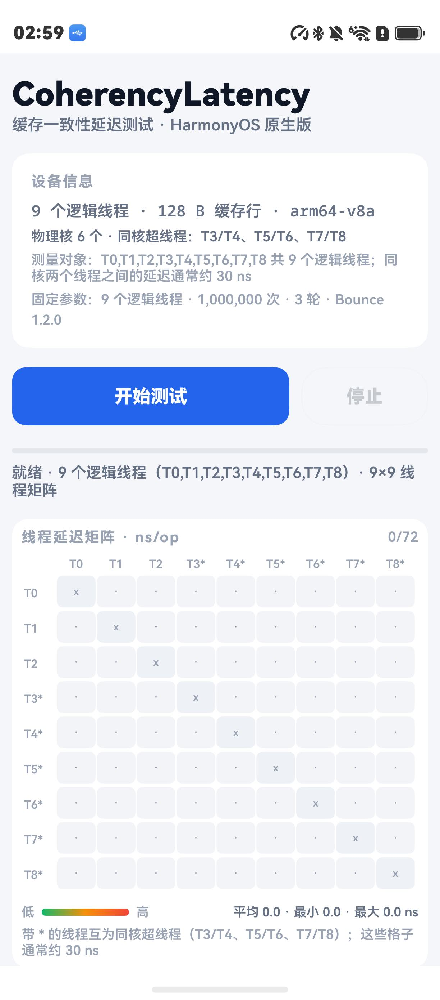
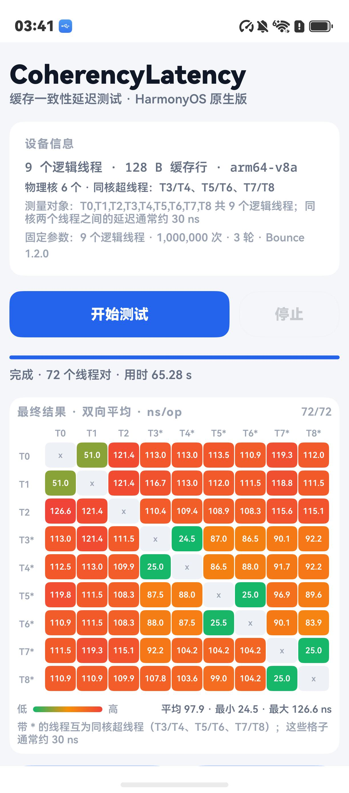

# CoherencyLatency 鸿蒙版 使用手册

**版本：** 1.2.0　|　**适用系统：** HarmonyOS 5.0.0（API 12）及以上，arm64-v8a / x86_64 设备（手机 / 平板 / 2in1）　|　**形态：** 图形界面应用（.hap）

## 1. 这是什么

CoherencyLatency 测量 CPU **逻辑线程之间**的缓存一致性延迟（核间延迟），单位纳秒（ns）。

原理：两个线程分别绑定到两个指定的逻辑线程上，对同一缓存行里的原子变量做往返读写（Bounce 模式），每轮记录起止时间，取多轮最小值。一次配对运行已经包含 i→j 与 j→i 两个方向，结果除以 2 后同时填入矩阵的对称两格。

- 数值越低越好。
- 同一物理核的两个超线程（SMT 兄弟）通常明显更低，跨物理核会高出一截。
- 这是实测值，会随系统负载、温度、性能模式变化。

## 2. 安装

### 2.1 前提

- 设备已开启开发者模式与 USB 调试。
- 电脑已安装 hdc（DevEco Studio 自带，或 HarmonyOS SDK 的 toolchains 目录）。

### 2.2 先签名，再安装

本包不包含已签名 HAP。先按同目录《自行签名说明》完成签名，再执行：

~~~bash
hdc install -r CoherencyLatency-HarmonyOS-1.2.0-signed.hap
~~~

> **签名说明**：本包只提供**未签名 HAP**，不能直接安装。请先按同目录《自行签名说明》用 DevEco Studio 自动签名，或用自己的证书 + Profile 签名；调试签名会绑定设备 UDID，换设备要重新生成 Profile。

### 2.3 启动

安装后桌面出现「核间延迟」图标，点击即可。也可以用命令启动：

~~~bash
hdc shell aa start -a EntryAbility -b com.example.coherencylatency
~~~

## 3. 界面说明

从上到下依次是：

1. **标题区**：CoherencyLatency / 缓存一致性延迟测试 · HarmonyOS 原生版。
2. **设备信息卡片**：逻辑线程数、缓存行字节数、ABI；物理核数与超线程配对（例如 T3/T4、T5/T6、T7/T8）；「测量对象」说明本次纳入矩阵的逻辑线程；固定参数行显示线程数、配置迭代次数、轮数与 Bounce 模式；底部是版本号 1.2.0。
3. **开始测试 / 停止按钮**
4. **进度条与状态行**：矩阵阶段显示 `已完成/总数 · T发送方↔T接收方 当前值 ns · 用时 x.x s`。状态行只在每完成一个线程对时刷新一次，两次结果之间数字保持不动（与 Android 版一致），不会高频跳动。
5. **结果矩阵**：N×N 矩阵（N 为实际纳入的逻辑线程数，2–20），行 = 发起方逻辑线程，列 = 接收方逻辑线程，对角线显示 `x`；`.` 表示尚未测到，`N/A` 表示该线程对绑定失败；颜色从绿（低）到黄再到红（高），只在本矩阵内相对比较；底部显示平均 / 最小 / 最大。线程较多、一屏放不下时，矩阵卡片可以左右滑动。
6. **复制 CSV / 另存一份**：测试完成后可用。

## 4. 开始测试

1. 建议先到「设置 → 电池」开启**性能模式**，并保持屏幕常亮。
2. 点「开始测试」。N 个线程共有 N×(N-1)/2 个无序线程对；例如 9×9 是 36 对、72 个方向，通常约 25–90 秒；20×20 是 190 对，通常需要数分钟。
3. 中途点「停止」可以立刻结束，已测完的格子保留为部分结果。

### 固定参数

| 参数 | 值 | 说明 |
| --- | --- | --- |
| 迭代次数 | 配置值 1,000,000；线程矩阵每轮 500 次 | 每轮内每个线程的原子操作次数；短轮次降低被调度器折叠或迁走的风险 |
| 采样轮数 | 每对每方向 800 轮，至少保留 64 轮有效样本 | 用多轮统计抵消偶发异常；样本不足自动重试，避免 1–2 个离谱轮次污染整格 |
| 模式 | Bounce | 两个线程互相把缓存行“打”给对方 |
| 单位 | ns/op | 每次原子操作的往返延迟 |
| 慢档重测 | 高于同核延迟的 5 倍（最低 80 ns，缺省 135 ns）时换反向窗口重测，最多 16 个窗口取最小 | 最高性能核存在整窗慢档，换窗口是可靠的逃逸方式 |
| 绑核重试 | 最高性能核 40 轮 / 普通跨核 8 轮 / 普通同核 20 轮；最高性能核交叉对再精确回退 24 次（间隔 20 ms） | 每次重试重新落核并采样；仍失败才显示 N/A |

## 5. 结果怎么读

- **看趋势，不要抠小数点**：同一台设备同一状态下，逐格跨次波动中位数约 4.5%，约八成格子 ≤10%，最高性能核行的个别交叉格可能到 20–60%；跨次比较建议交替顺序、至少连测 3 次看中位数。
- **成对对称**：矩阵只测 N×(N-1)/2 个无序线程对。每一对的 Bounce 测试本身就让两个线程往返各跑 `iterations` 次、总时间除以 2，所以得到的已经是双向平均延迟；把同一个双向平均值填入对称两格只是矩阵排版对称，不是只测单向再复制。如果该对绑定失败，两格同时显示 N/A。
- **同核超线程**：行列表头带 `*` 的线程互为同核 SMT 兄弟，这些格子通常 25–50 ns，明显低于跨核；本机示例 T3↔T4 约 26–30 ns、T7↔T8 约 25–50 ns、T5↔T6 约 35–80 ns（受频率与调度影响，波动较大）。
- **跨核**：本机示例约 105–290 ns；最高性能核的交叉对分布较宽，相邻编号的核心不一定更低，以实测为准。
- **N/A**：该线程对至少有一个线程没能真正绑到目标逻辑线程，程序不会拿错误的核的数据冒充结果。1.2.0 最终验收 72/72、0 N/A、65.28 s。厂商调度器在系统负载或温度变化时仍可能限制个别核心，出现 N/A 属平台限制。

## 6. 导出 CSV

测试完成后有两种方式：

- **复制 CSV**：把整张表复制到剪贴板，可粘贴到聊天窗口或表格软件。
- **另存一份**：在上一次保存的位置再写一份带时间戳的文件。

应用会自动保存一份到应用沙箱：

~~~text
/data/storage/el2/base/haps/entry/files/results/core_latencies_<时间戳>.csv
~~~

CSV 为分号分隔的 N×N 矩阵，行列表头是逻辑线程号，`N/A` 表示绑定失败。下面是 9×9 的示例（其它线程数格式相同）：

~~~text
;Thread 0;Thread 1;Thread 2;...;Thread 8
Thread 0;x;63.7;177.2;...;126.8
Thread 1;63.7;x;146.4;...;128.5
...
Thread 8;126.8;128.5;196.8;...;x
~~~

## 7. 动态拓扑与「可绑定核心」

应用**不使用机型白名单**，也不假设固定核数。每次启动按 sysfs 实测结果构建矩阵：

- 读取 `/sys/devices/system/cpu/online` 得到在线逻辑线程；
- 读取每个 CPU 的 `topology/thread_siblings_list`，同一物理核的两个线程标为 SMT 兄弟；
- 优先按 `physical_package_id` 分簇；读不到或不唯一时退回 `cpu_capacity`，再退回 `cpuinfo_max_freq`；
- 最高性能核按**单核** capacity（缺失时按最高频率）取全局最高档，避免把同一 package 里的中核误当大核；
- 矩阵尺寸 N 随实际线程数变化，支持 2–20；线程多时矩阵可横向滚动。

HarmonyOS 的部分机型会由厂商调度器接管 CPU 亲和性：应用对某些核心调用 `sched_setaffinity` 时，函数可能返回成功，但内核实际把线程放到别的核。因此应用会：

- 启动时逐线程探测能否稳定落核；
- 测量时每轮再次核实真实落点，落点不符时重试；
- 对最高性能核交叉对使用精确单线程掩码再试最多 24 次；
- 实在绑不住的线程对显示 N/A，不会用错误的核的数据冒充结果。

**跨版本/跨机型**：工程以 HarmonyOS 5.0.0（API 12）为最低兼容版本，targetSdkVersion 26.0.0；系统版本更高时直接沿用同一套 API。HarmonyOS 4.x 及更早版本未做真机验证，32 位 ABI 未提供。矩阵尺寸、SMT 标签、簇和最高性能核都从 sysfs 读取，因此同系统版本的不同机型通常不需要改程序，但仍需实机验证绑核可用性；换到没有 SMT、单簇或四簇的设备同样自适应。

本机示例：9 个逻辑 CPU、6 个物理核（CPU 3/4、CPU 5/6、CPU 7/8 为超线程对），矩阵为 9×9。换一台设备，线程数、SMT 标签、簇、最高性能核与矩阵大小都会自动变化，不需要改程序。

## 8. 常见问题

**Q：为什么矩阵大小不是固定的 9×9？**  
A：矩阵按设备实际在线逻辑线程数构建。9×9 只是本机示例；最多支持 20 线程（20×20）。线程多时矩阵可以左右滑动。

**Q：只测 N×(N-1)/2 对，是不是测一半然后直接镜像？**  
A：不是。每一对的 Bounce 测试都让两个线程往返各跑 `iterations` 次，总时间除以 2，结果本身就是双向平均；上下三角填同一个值只是矩阵显示对称，不是用单向数据补另一格。原版源码里也注明可以跳过反向那一遍（“technically can skip the other way around”）。

**Q：为什么矩阵里还有 N/A？**  
A：厂商调度器在负载下可能不遵守对某些线程的亲和性设置。程序会对该线程重试；实在绑不住时该对两格同时显示 N/A，不会用单侧结果补另一侧。1.2.0 最终验收 72/72、0 N/A、65.28 s。若系统负载或温度很高，个别格子仍可能 N/A，属平台限制，不是程序缺陷。

**Q：数值每次都不一样？**  
A：正常。CPU 频率、温度、后台负载都会影响结果。固定性能模式、等设备温度稳定后再测，重复性最好。

**Q：测试时手机发热？**  
A：满负载测试，短时发热正常。测完退出即可。

**Q：能后台跑吗？**  
A：不能。应用切到后台会自动停止测试（避免系统调度干扰结果）。

**Q：能装到别的鸿蒙设备吗？**  
A：发布包是未签名 HAP，需要用你自己的证书/Profile 签名。调试 Profile 只允许安装到登记过的设备；发布 Profile 才能公开分发。详见《自行签名说明》。

## 9. 卸载

- 桌面长按「核间延迟」图标 → 卸载。
- 或命令行：

~~~bash
hdc uninstall com.example.coherencylatency
~~~

## 10. 版本与校验

- 版本：1.2.0（versionCode 1000207）
- 安装包：CoherencyLatency-HarmonyOS-1.2.0-unsigned.hap（未签名，需自行签名）
- 校验：见同目录 SHA256SUMS.txt

~~~bash
sha256sum -c SHA256SUMS.txt
~~~

## 11. 界面截图

| 主界面（就绪） | 测试结果（本机 9×9 示例） |
| --- | --- |
|  |  |
